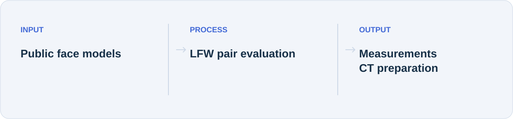

<!-- readme-header32:start -->

<h1 align="center" id="project-title">Face CT Transfer Project</h1>

Face-model evaluation and preparation for CT transfer

  
  

  
  
  
  
  

<small>LEVEL links open the Korean source at the same reading level.</small>

<picture>
  <source media="(max-width: 600px) and (prefers-color-scheme: dark)" srcset="../assets/readme/flow-en-dark-mobile.svg" />
  <source media="(max-width: 600px)" srcset="../assets/readme/flow-en-light-mobile.svg" />
  <source media="(prefers-color-scheme: dark)" srcset="../assets/readme/flow-en-dark.svg" />
  <source media="(prefers-color-scheme: light)" srcset="../assets/readme/flow-en-light.svg" />
  
</picture>
<!-- readme-header32:end -->

Latest measurement: LFW accuracy over 6,000 pairs·10fold is **99.9%** (rounded to one decimal place; original value 99.85%). This is −0.02%p from the authors' reported 99.87%, and an independent recalculation agreed. IJB-C remains unmeasured, and input-identity limitations remain.

<!-- reading-levels17:start -->
| Reading level | What the guide covers |
| --- | --- |
| [LEVEL 1 - Beginner (Korean source)](../docs/%EC%9D%BD%EA%B8%B0%EC%95%88%EB%82%B4/%EB%A0%88%EB%B2%A81.md) | Unfamiliar terms and concrete examples from input to result |
| [LEVEL 2 - Explorer (Korean source)](../docs/%EC%9D%BD%EA%B8%B0%EC%95%88%EB%82%B4/%EB%A0%88%EB%B2%A82.md) | The relationships between key concepts and processing steps |
| [LEVEL 3 - Practitioner (Korean source)](../docs/%EC%9D%BD%EA%B8%B0%EC%95%88%EB%82%B4/%EB%A0%88%EB%B2%A83.md) | Experiment and usage procedures, and how to interpret results |
| [LEVEL 4 - Advanced (Korean source)](../docs/%EC%9D%BD%EA%B8%B0%EC%95%88%EB%82%B4/%EB%A0%88%EB%B2%A84.md) | Code structure, settings, design choices, and constraints |
| [LEVEL 5 - Expert (Korean source)](../docs/%EC%9D%BD%EA%B8%B0%EC%95%88%EB%82%B4/%EB%A0%88%EB%B2%A85.md) | Papers, protocols, denominators, leakage, and unverified scope |
<!-- reading-levels17:end -->

[Actual evaluation details (Korean source)](../1단계/2차/reports/TopoFR_LFW_실제_평가_결과.md) · [Machine-readable aggregate](../1단계/2차/reports/lfw_official_result.json) · [Model selection and dated progress records (Korean source)](../1단계/2차/reports/모델_선정과_현재_진행.md)

| Component | Description |
| --- | --- |
| Purpose | First verify the original performance of a public face model, then compare transfer to lung CT classification and the effects of image filters. |
| Input | A public pretrained checkpoint and officially supplied aligned face-evaluation materials. |
| Method | Measure performance through face-feature extraction and evaluation-pair comparisons, then recalculate independently from saved features. |
| Result scope | Distinguish the measured face results below, pending external materials, and subsequent CT research. |

## Actual LFW evaluation — 2026-11-03

TopoFR-R200 Glint360K was evaluated on 6,000 pairs from the aligned LFW supplied with official MS1MV2, yielding a 10fold mean accuracy of **99.85%**.

There were 5,991 correct and 9 incorrect decisions (9 false rejections of the same person·0 false acceptances of different people), with fold standard deviation 0.203443%p (ddof=0). Standard deviation is not a confidence interval. The difference from the authors' reported 99.87% is −0.02%p.

The 12,000 image inputs include repetitions and do not mean 12,000 unique images or individuals.

The actual GPU evaluation completed at 15:52:20~16:01:53 Korean time using FP32·batch4 and summed original/horizontally flipped features. Thresholds were selected on 5,400 pairs separate from each test fold, and each of the 6,000 pairs was evaluated once.

Without retraining, deleting pairs, or changing preprocessing to fit the results, an independent verifier other than the implementer recalculated NumPy distances, thresholds, and 10fold figures from saved features and confirmed agreement.

The complete SHA of the bin used by the authors at their evaluation time, and pixel identity between MXNet/OpenCV decoding, are unverified. Therefore, this does not claim exactly identical input reproduction, statistical equivalence, or absolute world-best performance.

The main comparison metric, IJB-C TAR97.84%@FAR=1e-4, remains an author-reported value; IJB-C is awaiting external service quota. The LFW measurement does not establish IJB-C, medical/clinical, or all-stage completion.

A subsequent update within the same Stage 1 Revision 2 incorporated a restricted primitive loader, an official-input cache, evaluation execution, and related tests and documents.

No new revision or set of 30 studies was created.

The original 26 files and the earlier YuNet70 failure aggregate are preserved; the working version uses 28 freeze10 backend files and the same 18 frontend files.

Actual face/CT images, individual features, predictions, scores, weights, and operational logs are not public.

Only technical progress reports and anonymous aggregates are published; there is no paper manuscript.

## Record from the previous preparation release

The unmeasured, unexecuted, and deferred-development statements below describe preparation commit f221d44. They are distinct from the measurements and subsequent validation above.

The plan first reproduces a public pretrained model's original face-evaluation performance, then compares lung CT diagnostic classification and image-filter effects. Code and technical records distinguish original reports, direct measurements, implementation checks, and external dependencies awaiting access.

Fields: Computer vision · Face benchmarks · Transfer learning · Medical image classification · Live status dashboard

[All stages and revisions (Korean source)](../docs/REVISION_INDEX.md) · [New model and current progress (Korean source)](../1단계/2차/reports/모델_선정과_현재_진행.md) · [Dashboard and execution (Korean source)](../1단계/2차/README.md) · [Full changes in this update (Korean source)](../docs/STAGE1_REVISION2_DIFF.md) · [Change history (Korean source)](../CHANGELOG.md)

## Model and measurement scope at preparation time

At preparation time, actual LFW and IJB-C performance of TopoFR-R200 Glint360K in Stage 1 Revision 2 was **unmeasured**. LFW was subsequently measured as described above; IJB-C remains unmeasured.

Author-reported IJB-C TAR is 97.84% at FAR =1e-4 and 96.71% at FAR =1e-5; reported LFW accuracy is 99.87%.

Values for other model sizes, training materials, or FAR conditions are not treated as reproduced performance of this public checkpoint.

The model was selected within the compared public candidates; this is not an absolute-best claim covering all commercial and unreleased models.

The 1,214,223,369-byte TopoFR weights were downloaded and their initial complete SHA-256 was fixed. No official complete checksum was supplied, so fixing local bytes is distinguished from matching an official checksum.

LFW materials and evaluation pairs were received and checked against the supplied hashes. The first strict CPU loading attempt on the original model at 12:08 failed because required constructor arguments were missing. After restoring the authors' feature dimension 512 and class count 360,232, the CPU loading check passed with exit 0 at 12:14:53. It loaded 1,808 tensors and 303,272,704 parameters with weights_only =True·strict =True, and 19 backend tests passed.

Actual face inference and accuracy were unmeasured at that time.

Pre-execution validation is distinct from later face-performance measurement. The IJB archive could not be obtained because Drive returned a quota-exceeded HTML page; this restriction is not bypassed.

The live dashboard connects an actual read-only API with a WebGL 3D workflow.

Checks covered formatting, process wording, 19 log regression tests, a production build, and actual browser controls for pause/play, stage selection, original-report/measured-result tabs, and log filtering/refresh.

These do not establish face accuracy or completion of independent validation of the entire system.

Actual runtime rendering at mobile sizes and with reduced motion remained unverified because of tool limitations.

## Actual stages and revisions

| Revision | Material folder | Description and previous comparison |
| --- | --- | --- |
| Stage 1 Revision 1 | [Materials](../1단계/1차) | [Synthetic-diagnostic overview (Korean source)](../1단계/1차/reports/총괄_보고서.md) [Initial comparison (Korean source)](../docs/INITIAL_DIFF.md) |
| Stage 2 Revision 1 | [Materials](../2단계/1차) | [Earlier CT preparation and execution record (Korean source)](../2단계/1차/README.md) [Full comparison at that time (Korean source)](../docs/STAGE2_PREPARATION_DIFF.md) |
| Stage 1 Revision 2 | [Materials](../1단계/2차) | [New face model, measured LFW results, and live dashboard (Korean source)](../1단계/2차/README.md) [Full comparison since the previous public baseline (Korean source)](../docs/STAGE1_REVISION2_DIFF.md)  [Dashboard update comparison (Korean source)](../1단계/2차/화면통합_비교/README.md) |

The earlier AdaFace CT run was stopped at the user's request; originals, checkpoints, and partial results are preserved. “Running” labels in historical documents describe their own time and do not instruct a current resume.

The 30 synthetic-diagnostic items in Stage 1 Revision 1 are neither face accuracy nor 30 training runs. The planned 30 configurations for Stage 2 are not counted as completed experiments with the new model. Stage 3 and the final version are incomplete.

## Reproduction and follow-up research

LFW uses the fixed 6,000 pairs·10-fold; IJB-C evaluation distinguishes template/media handling and TAR/FAR conditions.

Differences between a new aligner and the authors' aligned inputs must be recorded.

After directly verifying face performance, CT transfer will compare identical splits, preprocessing, training budgets, and filters in a new revision.

Patient-group validation on materials with verified patient mappings is kept separate from exploratory materials whose mappings are unverified.

[Execution and constraints for the new revision (Korean source)](../1단계/2차/README.md) · [Face-evaluation requirements (Korean source)](../1단계/2차/docs/요구사항.md) · [Status API (Korean source)](../1단계/2차/docs/상태_API.md) · [Preserved common protocol (Korean source)](../1단계/1차/docs/공통_실험_프로토콜.md)

## Public scope and usage conditions

Only code, settings, tests, aggregate technical reports, and font licenses are public. Original face/CT images, individual predictions, embeddings, training weights, private operational records, personal instructions, and execution caches are excluded. Original-model code, weights, and training materials remain subject to their own terms; no arbitrary permission to redistribute data is added.

[TopoFR author code](https://github.com/DanJun6737/TopoFR) · [Original paper](https://arxiv.org/html/2410.10587v1) · [LUNA25 images](https://zenodo.org/records/14223624) · [LUNA25 annotations](https://zenodo.org/records/14673658)

These materials are technical progress records. There is no paper manuscript, corresponding manuscript PDF, or clinical-validation result, and no claim of guaranteed anonymity or actual best accuracy. AI assistance was used in writing and checking code and documents.

## Preparation-time checks and observations — 2026-11-03

This section records preparation and failures before the actual LFW evaluation. See the latest-measurement section above for subsequent evaluation results.

Independent pre-execution validation passed 72 Python tests, 19 Node tests, and the frontend build.

That public code version uses the preserved 26-file backend validated at the time and 18 frontend files.

It does not include the restricted primitive reader or new tests then under development.

Code tests are not face-performance reproduction results.

The CPU weights check loaded 1,808 tensors and 303,272,704 parameters with weights_only =True·strict =True.

IJB-C TAR97.84%@FAR=1e-4·96.71%@FAR=1e-5 and LFW99.87% were author-reported, not direct measurements at that time.

The model was selected among public candidates under comparable conditions; this does not claim absolute superiority over all commercial and unreleased models.

The first actual preparation failed after original extraction when loading a Korean-named ONNX file.

The loading path was changed to pass the bytes with the same official SHA through the official buffer API.

The second preparation failed with WinError5 during atomic status-file replacement while alignment progress was 3975/7701.

A bounded retry for temporary file contention was added; the actual process holding the file was not identified.

The earlier 75-second formal-check timeout is preserved as a failure. A later formal check passed, but the original cause was not established.

The third preparation checked all 7,701 images at 14:43:39~14:45:15, recording 7,631 successes·70 failures·511 multiple-face cases.

The 99.0910% detection/alignment success rate is not face-recognition accuracy.

Because all fixed 6,000 pairs could not be prepared, it ended with protocol_unmet. Failed pairs were not deleted or replaced through arbitrary resizing.

There were 0 TopoFR GPU-inference runs or face-accuracy calculations at this stage.

The single faces_emore/lfw.bin file was obtained from the official InsightFace MS1MV2 ZIP through normal 206 range responses.

Checks confirmed the decompressed size of 64,738,112 bytes, CRC32 2d7d0c73, DEFLATE termination, and trailing data.

The initial local SHA-256 is 9b711dca71a47fc9f295a28514abe8cc4e457632a8d634264691398c99569593; it was not matched against a separately published author SHA.

Non-executing static inspection found 30,044 opcodes·12,000 image strings·3,000 true and 3,000 false values·GLOBAL/REDUCE0·0 trailing bytes.

This does not mean general pickle deserialization, image decoding, or recognition evaluation had been completed.

Identity with the bytes used in the authors' TopoFR evaluation remains unverified.

IJB-C is awaiting external service quota.

The earlier AdaFace CT run remains stopped and preserved at the user's request and is not mixed into results for the new model.

Mobile and reduced-motion runtime checks are unverified.

On desktop, the accessibility tree confirmed actual WebGL pause/play, stage selection, logs, the empty measured-results state, the images/second label, and a throughput observation of 159.

The screenshot of the upper screen is distinct from visual evidence for the lower label.

These materials record technical progress in code, settings, and aggregates. Individual checks or repairs are not counted as 30 studies or 30 training runs. A paper PDF is not applicable because there is no paper manuscript.

At that time, actual face evaluation and subsequent CT research were incomplete. LFW evaluation has since completed; follow-up CT research remains incomplete.

[Complete alignment aggregate](../1단계/2차/reports/lfw_yunet_coverage.json) · [Official-file acquisition and static aggregate](../1단계/2차/reports/lfw_official_acquisition.json)
